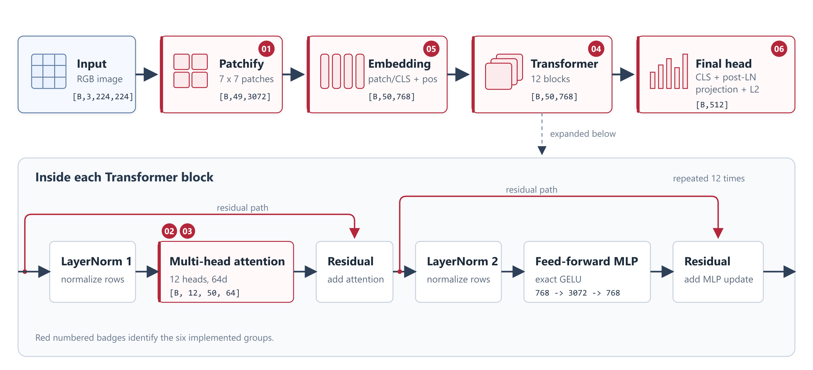

# Python Course Project 5: NumPy OpenCLIP ViT-B/32 Image Encoder

Repository: <https://github.com/Luo-start/project1-numpy-student>

This project implements the OpenCLIP ViT-B/32 image encoder as a fixed-weight
forward pass using only NumPy. It performs no training, does not require a GPU,
and does not import PyTorch or the OpenCLIP package.

## Objectives

- Reproduce the OpenCLIP ViT-B/32 image-tower computation in pure NumPy.
- Preserve the supplied model interface and `float32` numerical behavior.
- Match the independent reference at every staged numerical check.
- Export one L2-normalized 512-value output token per input image.

## Pipeline

```text
Image [B,3,224,224]
  -> patchify [B,49,3072]
  -> patch projection, CLS token, positional embedding [B,50,768]
  -> pre-Norm
  -> 12 Transformer blocks [B,50,768]
  -> select CLS [B,768]
  -> post-Norm
  -> projection [B,512]
  -> unit normalization [B,512]
```
## Architecture

<p align="center">
  
</p>

## Implemented Components

| Exercise | Implementation | Shape |
| --- | --- | --- |
| TODO-01 | `ImageEncoder.patchify` | `[B,3,224,224] -> [B,49,3072]` |
| TODO-02 | `MultiHeadAttention.split_heads` | `[B,N,768] -> [B,12,N,64]` |
| TODO-03 | `MultiHeadAttention.__call__` | scores, head merge, attention projection |
| TODO-04 | `TransformerBlock.__call__` | attention residual, MLP, second residual |
| TODO-05 | `ImageEncoder.embed` | patch projection, CLS concatenation, positions |
| TODO-06 | `ImageEncoder.__call__` | CLS selection, post-Norm, projection, normalization |

The implementation is in [image_encoder.py](image_encoder.py). The supplied
numerical helpers remain in [helpers.py](helpers.py).

## Numerical Results

The following values were measured locally with
`python check.py --stage all`.

| Stage | Output shape | Max absolute error | Mean absolute error | Result |
| --- | --- | ---: | ---: | --- |
| assets | 152 tensors, 10 image/reference pairs | - | - | PASS |
| preprocess | `(10,3,224,224)` | 0 | 0 | PASS |
| patches | `(2,49,3072)` | 0 | 0 | PASS |
| tokens | `(2,50,768)` | `4.005e-05` | `1.289e-06` | PASS |
| block0 | `(2,50,768)` | `7.063e-06` | `3.250e-07` | PASS |
| last_tokens | `(2,50,768)` | `4.768e-05` | `2.696e-06` | PASS |
| output | `(10,512)` | `5.439e-07` | `8.311e-08` | PASS |
| batch | `(3,512)` | `4.619e-07` | `7.632e-08` | PASS |

The exported [output_tokens.npz](output_tokens.npz) contains:

- `ids`: 10 image IDs in reference order.
- `output_tokens`: finite `float32` values with shape `(10,512)`.
- Every output row has unit L2 norm.

## Bug Fixed

The attention scale was initially computed as:

```python
scale = np.sqrt(self.head_dim)
```

`np.sqrt` returned a `float64` scalar and promoted the attention scores to
`float64`. The incorrect dtype then propagated through the Transformer block.
`check.py` reported:

```text
block0: use float32
```

The minimal fix was:

```python
scale = np.float32(np.sqrt(self.head_dim))
```

After the fix, `block0` passed with `max_abs=7.063e-06` and
`mean_abs=3.250e-07`.

## Environment

The reported results were produced with:

```text
Windows x64
Python 3.13.5
NumPy 2.4.4
Pillow 12.2.0
imageio 2.37.3
```

The dependency ranges are recorded in [requirements.txt](requirements.txt).

## Reproduce

Run these commands from the repository root in PowerShell:

```powershell
py -3.13 -m venv .venv
.\.venv\Scripts\python.exe -m pip install -r requirements.txt
.\.venv\Scripts\python.exe check.py --stage all
.\.venv\Scripts\python.exe run.py --output output_tokens.npz
```

To encode custom images:

```powershell
.\.venv\Scripts\python.exe run.py --images path\to\a.jpg path\to\b.png --output my_tokens.npz
```

## Course Assets

Git intentionally excludes these course-provided files because they are large
or are reference data that should not be resubmitted:

```text
weights/image_encoder.npz
assets/reference_outputs.npz
```

They remain in the local working directory and are listed in
[.gitignore](.gitignore). To run all checks from a fresh clone, obtain these
files from the course attachment and place them at the exact paths above.

`weights/image_encoder.npz` contains the fixed 152 visual tensors for this
checkpoint. Substituting another OpenCLIP checkpoint is not supported because
the dimensions and numerical references in `config.json` are fixed.

## Repository Contents

- [image_encoder.py](image_encoder.py): student implementation of TODO-01 to TODO-06.
- [helpers.py](helpers.py): supplied LayerNorm, GELU, attention and vector helpers.
- [preprocess_image.py](preprocess_image.py): supplied resize, crop and normalization.
- [check.py](check.py): staged numerical checks against the reference.
- [run.py](run.py): command-line exporter for `ids` and output tokens.
- [config.json](config.json): fixed architecture and preprocessing configuration.
- [assets/images](assets/images): ten supplied local images.
- [weights/manifest.json](weights/manifest.json): tensor shapes, names and checksums.

## Contributions and Assistance

- Implementation and final numerical verification: project author.
- Codex assistance: code inspection, repository packaging, README drafting and
  transcription of locally measured results.
- No numerical result in this README is a placeholder or fabricated value.
